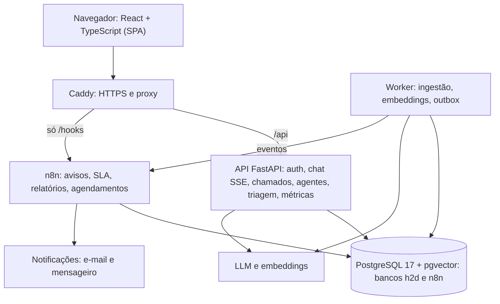
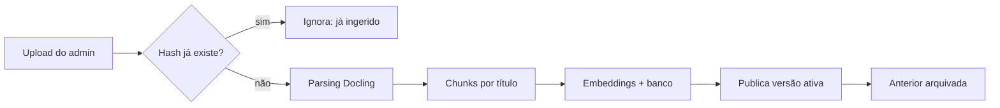
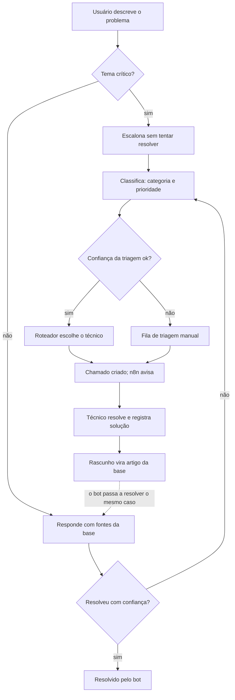
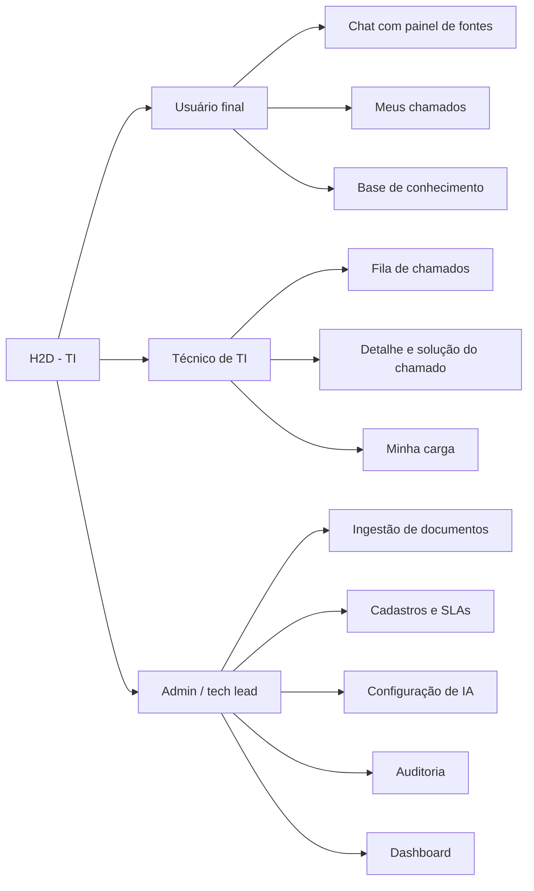

# H2D - TI: Plano de Projeto

Nov 4, 2026 · @Danúbio Costa Lagoa

## 1. Visão geral

O H2D - TI é uma central de atendimento de TI em que um chatbot com RAG resolve o que os manuais já respondem e só abre chamado, já classificado e atribuído a um técnico, quando a resolução automática falha.

**Problema.** Chamados repetitivos (senha, VPN, impressora, "como faço X") consomem o time de TI, e os manuais existem mas ninguém os encontra.

**Objetivo do MVP.** Resolver parte dos atendimentos no bot e entregar o restante ao técnico certo, com resumo, categoria, prioridade e o que já foi tentado. A meta de deflexão (chamados resolvidos sem humano) deve ser definida com dados do piloto; como ponto de partida, 30–40%.

**Premissa sobre o "mini ERP".** Interpretei como o cadastro e a gestão do atendimento (usuários, equipes, categorias, SLAs, chamados), e não como módulos financeiros ou de estoque. Se a ideia incluir inventário de ativos, entra na fase 2.

### Personas

| Persona | O que faz no sistema | Acesso |
| --- | --- | --- |
| Usuário final | Conversa com o bot, acompanha seus chamados, consulta a base de conhecimento | Portal |
| Técnico de TI | Recebe chamados atribuídos, vê o resumo e as fontes consultadas, resolve e registra a solução | Fila de chamados |
| Admin / tech lead | Ingere documentos, gerencia equipe, categorias, SLAs e regras de roteamento, acompanha o dashboard | Área administrativa |

### Escopo: MVP e fase 2

| Módulo | MVP (entrega do curso) | Fase 2 |
| --- | --- | --- |
| Portal do usuário | Login, chat, meus chamados, busca na base | SSO (Google/Microsoft), anexos e prints, PWA |
| Chatbot com RAG | Resposta com citação da fonte, feedback 👍/👎, escalonamento para chamado | Chat ao vivo com o técnico, entrada multimodal |
| Agente classificador | Categoria, prioridade, resumo e nível de confiança | Sugestão de solução ao técnico a partir de chamados antigos |
| Atribuição | Regras por habilidade, carga atual e disponibilidade | Escala de plantão, reatribuição automática por SLA |
| Ingestão (admin) | Upload de PDF/DOCX/MD, status do job, versionamento, reindexação | Conectores Drive/SharePoint via n8n, OCR em escaneados |
| Dashboard | KPIs de volume, deflexão, tempo de resposta, SLA, carga por técnico | Custo de LLM por chamado, lacunas da base, exportação |
| Automações (n8n) | Aviso de novo chamado, alerta de SLA, relatório semanal | E-mail para chamado, Teams/WhatsApp, escalonamento |
| Mini ERP | Usuários, equipes, habilidades, categorias, SLAs | Inventário de ativos, catálogo de serviços |

## 2. Arquitetura



O navegador fala só com o Caddy, que encaminha para a API e, apenas para webhooks, para o n8n. O worker entrega ao n8n os eventos gravados no outbox; o n8n devolve chamadas à API por webhook assinado. Banco, LLM e canais de notificação ficam atrás dos serviços, nunca expostos ao navegador.

## 3. Stack recomendada

A recomendação é Python no backend, React com TypeScript no frontend e um único PostgreSQL com pgvector para dados, vetores e busca textual. Python entra porque as bibliotecas de parsing, RAG e agentes (Docling, LangGraph, Pydantic AI, Ragas) nascem nele.

| Camada | Escolha | Por quê | Alternativa |
| --- | --- | --- | --- |
| Frontend | React 19 + TypeScript + Vite (SPA); TanStack Router, Query e Table; Tailwind v4 + shadcn/ui; Zod + react-hook-form; cmdk (paleta Ctrl+K) | Área logada não precisa de SEO nem de SSR; SPA estática gasta quase nada de RAM na VPS | Next.js, se quiserem SSR |
| Contrato de API | OpenAPI do FastAPI + openapi-typescript (tipos gerados) | Front e back nunca divergem: o CI quebra se o contrato mudar | tRPC (só se o back for TS) |
| Gráficos | uPlot ou Recharts | uPlot é pequeno e rápido, bom para painel denso | ECharts |
| Backend | Python 3.12 + FastAPI + Pydantic v2; SQLAlchemy 2 + Alembic; uv; ruff; pytest | Async, validação tipada, SSE nativo, ótimo ecossistema de IA | NestJS/Fastify (ver decisão abaixo) |
| Jobs assíncronos | Procrastinate (fila dentro do Postgres) | Ingestão e reindexação rodam fora da requisição sem subir Redis | Redis + Dramatiq |
| Banco | PostgreSQL 17 + pgvector (índice HNSW) + tsvector `portuguese` + pg\_trgm | Relacional, vetor e busca textual no mesmo banco e na mesma consulta | Qdrant, só se o volume pedir |
| Embeddings | Modelo multilíngue (BGE-M3 ou multilingual-e5 via FastEmbed, ou API) | Manuais em português; gravar o nome do modelo em cada chunk permite reindexar depois | OpenAI/Cohere via API |
| Acesso a LLM | OpenRouter atrás de um cliente fino próprio; modelo pequeno para classificar, médio para responder | Troca de modelo por variável de ambiente e uma conta só para custo | LiteLLM proxy |
| Agentes | LangGraph (estado e handoff) + saídas estruturadas em Pydantic; checkpointer no Postgres | O fluxo do chat tem estados e desvios (resolveu / escalona); grafo expressa isso | Pydantic AI, mais leve |
| Parsing de documentos | Docling; MarkItDown como reserva | PDF/DOCX/PPTX/HTML para Markdown preservando tabelas e títulos | Unstructured |
| Reranking (fase 1.5) | bge-reranker-v2-m3 (FastEmbed) ou API de rerank | Melhora a precisão dos 5 primeiros trechos; só ligar se a avaliação mostrar ganho | — |
| Automação | n8n self-hosted (Community) com banco próprio | Notificações, SLA, relatórios e conectores sem código | Windmill, Temporal |
| Autenticação | JWT em cookie httpOnly + argon2; papéis user / tech / admin | Simples e seguro para o MVP; SSO por OIDC na fase 2 (Authlib) | Keycloak (pesado para a VPS) |
| Tempo real | SSE para o streaming do chat e para a fila | Mais simples que WebSocket e atravessa proxy sem ajuste | WebSocket |
| Proxy e TLS | Caddy (HTTPS automático) | Um arquivo de configuração de poucas linhas | Traefik, Nginx |
| Observabilidade | structlog + tabela `llm_calls` (tokens, latência, custo) + Sentry/GlitchTip + Uptime Kuma | Langfuse self-hosted exige várias peças extras; não cabe bem numa VPS pequena | Langfuse Cloud, Phoenix |
| Qualidade | pytest, vitest, Playwright (fluxo chat → chamado), Ragas ou promptfoo, pre-commit | Avaliação de RAG e do classificador entra no CI | DeepEval |
| CI/CD | GitHub Actions → imagens no GHCR → deploy por SSH na VPS | Grátis para o tamanho do projeto | Coolify ou Dokploy na VPS |

### Por que PostgreSQL

Para este projeto o PostgreSQL com pgvector é a melhor opção gratuita: o [pgvector segue como o caminho mais pragmático](https://www.dio.me/en/articles/hybrid-search-em-2026-o-que-mudou-nos-vetores-18e6390ec75a) para quem já usa PostgreSQL, e a versão 0.8.0 trouxe varreduras iterativas de índice que melhoram consultas filtradas. Isso importa aqui, porque toda busca será filtrada por visibilidade do documento (público, só TI). A busca híbrida (texto + vetor) roda em SQL, fundida por [Reciprocal Rank Fusion](https://railway.com/guides/hybrid-search-postgres-pgvector), sem motor de busca separado.

### Decisão em aberto: Python ou TypeScript no backend

Se ninguém do time domina Python, um backend 100% TypeScript (Fastify ou NestJS, Drizzle, Vercel AI SDK) funciona e permite compartilhar tipos com o front. O custo é perder o Docling e rodar o parsing como um pequeno serviço Python à parte. Recomendo Python; confirme com os dois colegas antes da Sprint 0.

### Sobre o n8n e a licença

O n8n usa a Sustainable Use License: [permite uso interno e não permite revender ou hospedar o n8n para terceiros](https://www.activepieces.com/blog/n8n-license-fair-code-community-enterprise-2026). Para um projeto interno e acadêmico está tudo certo. Se o H2D - TI virar produto vendido a clientes e o n8n for parte do que se entrega, será preciso acordo comercial com a n8n.

## 4. Ingestão de dados e RAG

A qualidade do bot depende mais da ingestão e da avaliação do que do modelo de linguagem: documento mal fatiado gera resposta ruim, seja qual for o LLM. Os números abaixo são pontos de partida a calibrar com o conjunto de avaliação.



O hash do arquivo evita reprocessar duplicata; a versão anterior só é arquivada depois que a nova está publicada.

### Pipeline de ingestão (worker assíncrono)

1. **Registro.** O admin envia o arquivo com metadados: fonte, categoria, dono, visibilidade (público ou só TI) e validade. O hash SHA-256 detecta duplicata ou versão nova do mesmo documento.
2. **Parsing.** Docling converte PDF, DOCX, PPTX e HTML em Markdown estruturado, mantendo tabelas e títulos. O original fica guardado.
3. **Limpeza.** Remove cabeçalho e rodapé repetidos e normaliza espaços e numeração.
4. **Chunking por estrutura.** Corta nos títulos, com 500 a 800 tokens e 10 a 15% de sobreposição. Tabelas e listas de passos numerados não são partidas ao meio. Cada chunk leva o caminho de títulos ("VPN > Windows > Erro 809") no texto indexado.
5. **Embedding e gravação.** Embeddings em lote; cada chunk guarda vetor, `tsvector`, metadados, versão do documento e o nome do modelo de embedding.
6. **Publicação atômica.** A nova versão só vira ativa quando todos os chunks foram gravados. A anterior passa a `archived`: sai da busca, mas o histórico fica.
7. **Status visível.** O admin acompanha o job (na fila, parsing, embedding, concluído, falhou + motivo) e pode reprocessar.

### Pipeline de consulta

1. **Reescrita da pergunta** com o histórico da conversa, para a busca receber uma frase autossuficiente.
2. **Filtro de permissão** no próprio SQL: usuário comum nunca recebe chunk de documento restrito à TI.
3. **Busca híbrida:** 30 candidatos por vetor e 30 por texto, fundidos por RRF, ficando com os 8 melhores.
4. **Rerank opcional** reduz para 5, ligado só se a avaliação mostrar ganho.
5. **Geração** com instrução de responder apenas com base nos trechos, citar a fonte de cada afirmação e dizer "não encontrei" quando os trechos não bastam.
6. **Confiança.** Combina o score da recuperação com uma checagem de fidelidade (a resposta está sustentada pelos trechos?). Abaixo do limiar, o bot não responde e escalona.
7. **Registro completo:** trechos usados, scores, versão do prompt, tokens e latência, tudo em `llm_calls`.

### Segurança do conteúdo

Documentos são conteúdo não confiável. Os trechos entram no prompt dentro de um bloco delimitado e tratado como dado; o agente que responde não tem ferramenta de escrita, então uma instrução escondida num manual não consegue abrir chamado, alterar usuário nem chamar URL.

### Manutenção da base

- Documento com validade vencida gera aviso ao dono via n8n.
- Trocar o modelo de embedding exige reindexar tudo; por isso o modelo fica gravado em cada chunk.
- Perguntas sem resposta e respostas com 👎 alimentam a lista de lacunas da base no dashboard.

### Avaliação

Monte um conjunto de 50 a 100 perguntas com a resposta esperada e o documento-fonte, escritas pelo time a partir dos manuais. Medir: acerto do trecho certo entre os top-k, fidelidade da resposta, correção e taxa de "não sei" correto. Roda no CI sempre que mudar prompt, chunking ou modelo. Como ainda não há manuais reais, a Sprint 1 inclui criar de 10 a 15 manuais fictícios realistas (VPN, e-mail, impressora, senha, acesso a sistemas) que servem de base e de demonstração.

## 5. Agentes, triagem e atribuição

São três peças com papéis separados: um agente conversacional que tenta resolver, uma chamada de classificação com saída estruturada e um roteador determinístico que escolhe o técnico. Apenas a primeira é um agente de verdade; as outras duas são mais fáceis de testar justamente por não serem livres.

### Fluxo de atendimento



Tema crítico segue direto para a classificação. Nos demais casos o bot responde primeiro; só quando não resolve (ou a confiança é baixa) o chamado nasce, já com categoria e prioridade. A solução do técnico volta para a base e fecha o ciclo.

### 1. Agente de atendimento (chatbot)

Implementado como grafo no LangGraph, com estado salvo no Postgres. Ferramentas disponíveis, todas somente leitura: `search_kb` e `get_my_tickets`. A abertura de chamado não é uma ferramenta que o modelo chama quando quer: o grafo decide escalonar a partir de regras.

**Gatilhos de escalonamento**

- O usuário pede um humano.
- A confiança da resposta fica abaixo do limiar.
- Duas tentativas sem resolver (👎 ou "não resolveu").
- Tema crítico: incidente de segurança, sistema fora do ar, pessoa impedida de trabalhar. Nesses casos o bot nem tenta resolver.
- Pergunta fora do escopo da TI.

Antes de escalonar, o bot faz no máximo 3 perguntas de esclarecimento (sistema afetado, mensagem de erro, desde quando, quantas pessoas), para o chamado nascer completo.

### 2. Classificador

Uma chamada única, temperatura 0, modelo pequeno, que recebe a transcrição, os trechos já consultados e o perfil do usuário (setor, VIP) e devolve um objeto validado por Pydantic:

| Campo | Conteúdo |
| --- | --- |
| `categoria`, `subcategoria` | Valores da tabela de categorias cadastrada no admin; o modelo não inventa categoria |
| `impacto`, `urgencia` | Alto / médio / baixo, com justificativa curta |
| `prioridade` | Calculada em código pela matriz abaixo, não pelo modelo |
| `resumo` | Até 5 linhas para o técnico ler em 10 segundos |
| `ja_tentado` | O que o bot sugeriu e o que o usuário já fez |
| `habilidades` | Competências necessárias, do mesmo catálogo dos técnicos |
| `confianca` | 0 a 1, mais o motivo |

| Impacto \\ Urgência | Alta | Média | Baixa |
| --- | --- | --- | --- |
| Alto | P1 | P2 | P3 |
| Médio | P2 | P3 | P4 |
| Baixo | P3 | P4 | P4 |

Os prazos de SLA por prioridade ficam configuráveis na área admin; os valores iniciais precisam ser definidos com o time de TI.

### 3. Roteador de atribuição (regras, sem LLM)

1. Filtra técnicos ativos que têm a habilidade da categoria e estão disponíveis no horário.
2. Escolhe quem tem a menor carga, ponderada pela prioridade dos chamados abertos.
3. Empate: rodízio.
4. P1 notifica também o líder.
5. Se a confiança da classificação estiver abaixo do limiar ou ninguém for elegível, o chamado vai para a fila "triagem manual" do tech lead.

Regra em código é auditável: qualquer pessoa consegue ver por que o chamado caiu com aquele técnico, e cada atribuição grava o motivo em `ticket_events`.

### Guardrails

- O bot nunca pede nem aceita senha; se o usuário colar uma, a mensagem é mascarada antes de qualquer log ou envio ao LLM.
- Mascaramento de CPF, cartões e tokens (Presidio ou expressões regulares) antes de gravar logs.
- Limite de turnos e de tokens por conversa, e limite de requisições por usuário.
- Se o provedor de LLM cair, o chat oferece abrir o chamado direto, sem classificação, e a triagem acontece depois.
- O bot não promete prazo nem executa ações na infraestrutura.

### Ciclo de aprendizado

Ao fechar o chamado, o técnico registra a solução aplicada. O sistema gera um rascunho de artigo para a base de conhecimento, o admin revisa e aprova, e o texto entra pelo pipeline de ingestão. O problema que chegou ao humano hoje passa a ser resolvido pelo bot amanhã.

### Avaliação dos agentes

Conjunto rotulado de pelo menos 100 conversas (começando sintéticas) com a categoria e a prioridade esperadas. Métricas: acerto de categoria, concordância de prioridade com margem de um nível, escalonamentos desnecessários e falsas resoluções. Roda no CI a cada mudança de prompt ou modelo. Em produção, toda correção de categoria feita pelo técnico vira um novo caso de avaliação.

## 6. Modelo de dados e API

O banco tem cerca de 17 tabelas, em três grupos: cadastro, conhecimento e atendimento. Convenções: chaves UUID v7, `timestamptz` em tudo, migrações só por Alembic e dados de demonstração em um script de seed.

### Tabelas principais

| Grupo | Tabela | Para quê | Campos-chave |
| --- | --- | --- | --- |
| Cadastro | `users` | Todos os acessos | nome, e-mail, senha\_hash, role (user/tech/admin), setor, ativo |
| Cadastro | `technicians`, `skills`, `technician_skills` | Perfil de quem atende | capacidade máxima, horário (jsonb), disponível, habilidades |
| Cadastro | `categories` | Árvore de categorias | parent\_id, habilidade padrão, política de SLA |
| Cadastro | `sla_policies` | Prazos por prioridade | prazo de 1ª resposta, prazo de resolução |
| Conhecimento | `kb_documents` | Documento lógico | título, fonte, categoria, visibilidade, dono, validade |
| Conhecimento | `kb_document_versions` | Cada upload | hash, caminho do arquivo, status (active/archived), Markdown extraído |
| Conhecimento | `kb_chunks` | Trechos pesquisáveis | texto, breadcrumb, `embedding vector`, `tsv`, modelo, visibilidade copiada do documento |
| Conhecimento | `ingestion_jobs` | Fila e histórico de ingestão | versão, estado, erro, tempos |
| Atendimento | `conversations`, `messages` | Chat | status (aberta/resolvida/escalonada), citações (jsonb), feedback 👍/👎 |
| Atendimento | `tickets` | Chamados | solicitante, categoria, impacto, urgência, prioridade, resumo, status, responsável, confiança, prazo de SLA, CSAT |
| Atendimento | `ticket_events` | Linha do tempo | tipo (criado, atribuído, status, comentário), ator, payload, motivo da atribuição |
| Plataforma | `llm_calls` | Custo e depuração | finalidade, modelo, versão do prompt, tokens, latência, custo |
| Plataforma | `outbox_events` | Fila de eventos para o n8n | tipo, payload, status, tentativas |
| Plataforma | `audit_log` | Quem mudou o quê | ator, ação, entidade, antes/depois |

A visibilidade é copiada para cada chunk de propósito: o filtro de permissão roda na mesma consulta da busca, sem juntação extra.

### Endpoints

| Grupo | Endpoints principais | Acesso |
| --- | --- | --- |
| Autenticação | `POST /auth/login`, `POST /auth/logout`, `GET /auth/me` | Todos |
| Chat | `POST /chat/conversations`; `POST /chat/conversations/{id}/messages` (resposta em SSE); `POST /messages/{id}/feedback`; `POST /conversations/{id}/escalate` | user |
| Chamados | `GET /tickets`, `GET /tickets/{id}`, `PATCH /tickets/{id}` (status, reatribuir), `POST /tickets/{id}/comments`, `POST /tickets/{id}/resolve` | user (os próprios), tech, admin |
| Base de conhecimento | `GET /kb/search`, `GET /kb/documents/{id}` | user, tech |
| Ingestão | `POST /admin/kb/documents` (upload), `GET /admin/ingestion/jobs`, `POST /admin/kb/documents/{id}/reindex` | admin |
| Cadastros | CRUD em `/admin/users`, `/admin/technicians`, `/admin/categories`, `/admin/sla-policies`, `/admin/routing` | admin |
| Dashboard | `GET /metrics/overview`, `/metrics/tickets`, `/metrics/bot`, `/metrics/costs` | tech (leitura), admin |
| Integração | `POST /hooks/n8n/*` (assinatura HMAC); eventos de saída via outbox | n8n |
| Operação | `GET /health`, `GET /ready` | Monitoramento |

**Padrão outbox.** Quando algo relevante acontece (chamado criado, atribuído, SLA perto de vencer, documento ingerido), o backend grava o evento em `outbox_events` na mesma transação do dado. Um worker entrega o evento ao webhook do n8n com nova tentativa em caso de falha. Assim nenhuma notificação se perde se o n8n estiver fora do ar na hora.

## 7. Frontend: console monoespaçado e denso

O tema proposto é um console de operações: fundo escuro, uma única fonte monoespaçada, bordas finas, nada de sombra e muita informação por tela. Tema claro com os mesmos tokens, para quem preferir.

### Mapa de perfis e telas



O acesso é por papel (user, tech, admin). O técnico também lê o dashboard, mas só o admin altera cadastros e configuração de IA.

### Linguagem visual

- **Fonte:** JetBrains Mono em tudo (alternativa: IBM Plex Mono), 12 a 14 px, entrelinha 1,35. Por ser monoespaçada, colunas numéricas já se alinham.
- **Densidade:** grade de 4 px; linha de tabela com 28 px; botões com 28 px; células com 4 × 8 px de padding.
- **Superfícies:** borda de 1 px, raio de 2 px, sem sombra e sem gradiente.
- **Prefixos em texto:** `>` no campo de chat, `[P1]` e `[ABERTO]` como etiquetas, `▸` em itens expansíveis. O estado nunca depende só de cor.
- **Estrutura:** barra lateral fina com rótulos curtos; cabeçalho de página em forma de caminho (`/chamados/H2D-0142`); barra de status no rodapé (usuário, conexão SSE, versão).
- **Teclado primeiro:** `Ctrl+K` abre a paleta de comandos, `j`/`k` navegam a fila, `Enter` abre, `g` depois `t` vai para chamados, `/` foca a busca, `?` lista os atalhos.
- **Acessibilidade:** foco visível com contorno de 1 px na cor de destaque, `prefers-reduced-motion` respeitado, contraste mínimo de 4,5:1.

### Tokens de cor

Os contrastes foram estimados à mão; valide todos com uma ferramenta na Sprint 0 antes de congelar os tokens.

| Token | Escuro | Claro | Uso |
| --- | --- | --- | --- |
| `--bg` | `#0b0f12` | `#f6f7f8` | Fundo da página |
| `--surface` | `#11171c` | `#ffffff` | Painéis e tabelas |
| `--border` | `#25303a` | `#d5dbe0` | Linhas e divisórias |
| `--text` | `#cdd6dd` | `#1b2329` | Texto principal |
| `--muted` | `#7f8d99` | `#5a6772` | Texto secundário |
| `--accent` | `#3ddc97` | `#0f7a4d` | Ação principal e foco |
| `--warn` | `#f2b134` | `#8a5a00` | SLA perto de vencer |
| `--danger` | `#ff6b6b` | `#b3261e` | P1 e SLA estourado |
| `--info` | `#5aaeff` | `#1a5fb4` | Informação e links |

### Telas

| Perfil | Tela | Conteúdo |
| --- | --- | --- |
| Usuário | Chat | Conversa à esquerda; painel de fontes à direita com os trechos citados; 👍/👎 por resposta; botão "falar com a TI" |
| Usuário | Meus chamados | Tabela e linha do tempo de cada chamado |
| Usuário | Base de conhecimento | Busca e leitura dos documentos públicos |
| Técnico | Fila | Tabela densa e filtrável: ID, prioridade, tempo de SLA restante, categoria, solicitante, resumo, status |
| Técnico | Chamado | Resumo da IA, transcrição, fontes consultadas, ações, campo de solução aplicada (gera rascunho para a base) |
| Técnico | Minha carga | Chamados abertos por prioridade e idade |
| Admin | Ingestão | Upload, jobs em andamento, versões, reindexar |
| Admin | Cadastros | Usuários, técnicos e habilidades, categorias, SLAs, regras de roteamento |
| Admin | Configuração de IA | Versões de prompt, limiares de confiança, modelos por finalidade |
| Admin | Auditoria | Registro de alterações |

### Dashboard

| Indicador | Definição |
| --- | --- |
| Taxa de defleção | Conversas resolvidas sem chamado ÷ total de conversas |
| 1ª resposta humana | Tempo entre a criação do chamado e a primeira ação do técnico |
| MTTR | Tempo médio de resolução, por prioridade |
| SLA cumprido | Chamados dentro do prazo ÷ total de chamados fechados |
| Backlog | Chamados abertos por técnico e por idade |
| Volume | Chamados por categoria e por dia |
| CSAT | Nota média da avaliação ao fechar |
| Acerto da classificação | Chamados cuja categoria o técnico não corrigiu ÷ total |
| Lacunas da base | Perguntas sem resposta ou com 👎, agrupadas por tema |
| Custo de LLM | Gasto por conversa e por chamado, a partir de `llm_calls` |

### Organização do código

`apps/web/src/` com `routes/`, `features/` (chat, tickets, kb, admin, dashboard), `components/ui/` e `lib/api/` (cliente gerado do OpenAPI) e `styles/tokens.css`. Componentes próprios: `DataTable` virtualizada, `StatusTag`, `Kbd`, `CommandPalette`, `ChatStream`, `CitationCard`, `KpiTile` e `Sparkline`.

## 8. Automações com n8n

O n8n cuida de avisar, agendar e conectar sistemas; as regras de negócio (classificar, atribuir, calcular SLA) ficam no backend, onde têm teste e versionamento. Assim o n8n pode ser trocado ou ficar fora do ar sem quebrar o atendimento.

### Workflows previstos

| # | Workflow | Gatilho | O que faz | Fase |
| --- | --- | --- | --- | --- |
| 1 | Aviso de chamado | Webhook `ticket.created` / `ticket.assigned` | Notifica o técnico por e-mail e mensageiro com resumo, prioridade e link; P1 avisa também o líder | MVP |
| 2 | Vigia de SLA | Agendado, a cada 5 minutos | Consulta chamados em risco; alerta ao atingir 75% e 100% do prazo e escalona ao líder | MVP |
| 3 | Relatório semanal | Agendado, segunda de manhã | Busca `/metrics/overview` e envia resumo ao gestor de TI | MVP |
| 4 | Pesquisa de satisfação | Webhook `ticket.resolved` | Envia o link de avaliação ao solicitante após um intervalo | MVP |
| 5 | Erro global | Gatilho de erro do n8n | Avisa o canal de TI quando qualquer outro workflow falhar | MVP |
| 6 | Validade de documentos | Agendado, diário | Lista documentos que vencem em 15 dias e avisa o dono | Fase 1.5 |
| 7 | Ingestão por pasta | Novo arquivo no Drive ou SharePoint | Baixa o arquivo e chama `POST /admin/kb/documents` | Fase 2 |
| 8 | E-mail para chamado | Caixa IMAP | Cria conversa e deixa o fluxo normal de triagem rodar | Fase 2 |

### Regras de construção

- **Segurança dos webhooks.** Segredo no cabeçalho e assinatura HMAC nos dois sentidos. O backend recusa chamada sem assinatura válida.
- **Editor fora da internet.** O editor do n8n não fica público: acesso por VPN/túnel (Tailscale ou Cloudflare Access) ou, no mínimo, por lista de IPs. Só os webhooks passam pelo proxy.
- **Segredos.** Credenciais ficam no cofre do n8n; a `N8N_ENCRYPTION_KEY` fica fora do repositório e com cópia guardada, senão o backup do n8n não abre.
- **Versionamento.** Workflows exportados em JSON para `n8n/workflows/` e revisados em PR, sem credenciais. Cada pessoa testa numa instância local própria.
- **Idempotência.** Todo evento tem `event_id`; reentregas do outbox não duplicam notificação.
- **Banco.** n8n com PostgreSQL próprio (banco separado), não SQLite, e poda automática do histórico de execuções para não encher o disco.

## 9. Infraestrutura e deploy na VPS Hostinger

Tudo roda em Docker Compose numa única VPS, com Caddy na frente. Serve bem para o curso e para um piloto; o ponto fraco é ser um único servidor, e por isso o backup (abaixo) não é opcional.

### Dimensionamento

A linha KVM da Hostinger vai de 1 vCPU e 4 GB até 8 vCPU e 32 GB ([especificações](https://www.tomshardware.com/service-providers/web-hosting/hostinger-review-vps-cloud-and-shared-hosting)). Recomendação:

- **KVM 2 (2 vCPU, 8 GB RAM, 100 GB NVMe)** para o MVP, com embeddings e LLM por API.
- **KVM 4 (4 vCPU, 16 GB RAM, 200 GB NVMe)** se os embeddings e o reranker rodarem na própria VPS, ou se Docling com arquivos grandes estourar a memória.

O preço promocional costuma ser bem menor que o de renovação ([comparação de renovações](https://hostadvice.com/hosting-company/hostinger-reviews/vps-pricing/)); confira o valor vigente no contrato. Meu cálculo de memória é uma estimativa de 4 a 6 GB no total (PostgreSQL \~1 GB, API \~0,5 GB, worker 1,5 a 3 GB em picos de parsing, n8n \~0,5 GB, o resto em proxy e monitoramento); meça com `docker stats` na Sprint 1 e ajuste os limites de memória dos containers.

### Serviços do Compose

| Serviço | Imagem | Exposição | Observação |
| --- | --- | --- | --- |
| `caddy` | `caddy:2` | 80 e 443 públicos | TLS automático; serve a SPA; encaminha `/api` para a API e `/hooks` para o n8n |
| `api` | Build de `apps/api` | Interna | FastAPI com uvicorn, 2 workers |
| `worker` | Mesma imagem da API, outro comando | Interna | Procrastinate (ingestão, outbox); limite de memória definido |
| `db` | `pgvector/pgvector:pg17` | Apenas 127.0.0.1 | Volume nomeado; init cria os bancos `h2d` e `n8n` com usuários separados |
| `n8n` | `n8nio/n8n` com versão fixa | Só webhooks pelo proxy | Editor privado (ver seção 8) |
| `uptime-kuma` | `louislam/uptime-kuma` | Privada | Checa `/health` e os webhooks |

Dois endereços: `h2d.<seu-domínio>` (app e API) e `hooks.<seu-domínio>` (webhooks do n8n). Para o ambiente: local com Compose de desenvolvimento e produção na VPS; staging só se sobrar memória, como segunda stack com banco próprio.

### Segurança do servidor

- SSH só por chave, sem login de root nem senha; porta 22 limitada por IP ou acessível só pela VPN.
- `ufw` liberando 80 e 443; `fail2ban`; atualizações de segurança automáticas.
- PostgreSQL nunca exposto à internet; imagens com versão fixa; containers sem root quando possível.
- Segredos em `.env` fora do Git (ou versionados cifrados com sops + age); chaves de LLM com limite mensal de gasto configurado no provedor.
- Cookies `Secure` e `SameSite=Lax`, CORS restrito, HSTS e CSP no Caddy, limite de requisições por IP.
- Upload com tipo e tamanho limitados; varredura com ClamAV fica como melhoria da fase 2.

### Backup e recuperação

- `pg_dump` diário de `h2d` e `n8n`, comprimido e enviado com restic para armazenamento externo (Backblaze B2 ou Cloudflare R2). Retenção sugerida: 7 diários, 4 semanais, 3 mensais.
- O volume de arquivos originais entra no mesmo restic.
- `.env` e `N8N_ENCRYPTION_KEY` guardados em gerenciador de senhas, fora da VPS.
- Snapshot da VPS pelo painel antes de cada atualização grande.
- Teste de restauração uma vez por mês, com o passo a passo no runbook. Metas sugeridas: perder no máximo 24 h de dados e voltar ao ar em até 2 h.

### Deploy

O merge na `main` dispara o GitHub Actions: testes, build das imagens, envio ao GHCR e, após aprovação manual do tech lead, um SSH na VPS que roda `docker compose pull`, aplica `alembic upgrade head` e sobe os serviços com `up -d`. O pipeline termina chamando `/ready`; se falhar, o rollback é subir a tag anterior. Alternativa com menos script: Coolify ou Dokploy na própria VPS, ao custo de mais memória usada.

## 10. Fluxo de trabalho do time no GitHub

Com três pessoas, o fluxo deve ser leve: ramos curtos, PRs pequenos, revisão obrigatória do tech lead e um CI que pega o erro antes da revisão.

### Antes de tudo: proteção da `main`

A documentação do GitHub diz que [ramos protegidos estão disponíveis em repositórios públicos no plano Free](https://docs.github.com/en/repositories/configuring-branches-and-merges-in-your-repository/managing-protected-branches); em repositório privado, a regra só é aplicada em plano pago, e a [discussão da comunidade](https://github.com/orgs/community/discussions/209198) mostra que até conta pessoal Pro tem limitações, ficando o Team (organização) como caminho garantido. Resolva isto na Sprint 0, escolhendo uma opção:

1. Repositório **público**: proteção grátis, mas exige disciplina total com segredos (ver abaixo).
2. Repositório privado numa **organização com plano Team**: custo por usuário.
3. Benefícios educacionais do GitHub, se vocês forem elegíveis; confirme se cobrem organização.
4. Sem proteção imposta: valer pela convenção (ninguém faz push na `main`), apoiada pelo CODEOWNERS e pelo CI. É o plano C, porque depende de todos lembrarem.

### Estrutura do monorepo

```text
h2d-ti/
├─ apps/
│  ├─ api/            # FastAPI, workers, agentes, migrações
│  └─ web/            # React + TypeScript
├─ n8n/workflows/     # JSON exportado, sem credenciais
├─ infra/             # compose, Caddyfile, scripts de backup
├─ eval/              # conjuntos de avaliação de RAG e classificação
├─ docs/adr/          # decisões de arquitetura
├─ .github/           # workflows, templates, CODEOWNERS
├─ .env.example
└─ Makefile           # dev, check, seed, eval
```

### Ramos, commits e PRs

- **Trunk-based:** `main` sempre implantável; sem `develop`. Ramos curtos `feat/<nº da issue>-descricao`, `fix/`, `docs/`, `chore/`, com vida de poucos dias.
- **Commits e títulos de PR** no padrão Conventional Commits (`feat(chat): cita fonte na resposta`). Merge por squash.
- **PR pequeno,** idealmente abaixo de 400 linhas. Abrir como rascunho cedo para receber feedback cedo.
- **Revisão:** aprovação do tech lead obrigatória via CODEOWNERS; os colegas também revisam o código um do outro, o que ajuda todos a conhecerem o sistema.
- **Template de PR** com checklist: testes, migração de banco, nova variável de ambiente, captura de tela da UI, impacto em prompt ou avaliação.

### CI obrigatório em cada PR

| Verificação | Ferramentas |
| --- | --- |
| Backend | ruff, pyright, pytest com PostgreSQL+pgvector como service container |
| Frontend | eslint, `tsc --noEmit`, vitest |
| Contrato | Gera o OpenAPI e o cliente TS; falha se o `git diff` mostrar mudança não commitada |
| Avaliação de IA | Amostra de 10 casos de RAG e classificação em cada PR; conjunto completo em execução noturna, por causa do custo |
| Segurança | gitleaks, pip-audit, npm audit, Trivy nas imagens |
| Build | Construção das imagens Docker |

### Gestão do trabalho

- GitHub Projects com colunas Backlog, Pronto, Em andamento, Em revisão, Feito.
- Issues com modelos (funcionalidade, bug, tarefa técnica) e rótulos por área: `area:web`, `area:api`, `area:rag`, `area:n8n`, `area:infra`.
- Uma milestone por sprint. Decisões de arquitetura viram ADR em `docs/adr/` (a primeira: Python ou TypeScript no backend).

### Regras para quem contribui por PR

1. Assuma a issue antes de começar; uma issue, um PR.
2. Parta da `main` atualizada e faça rebase antes de pedir revisão.
3. Rode `make check` (lint + testes) localmente antes de subir.
4. Nunca commite `.env`, chaves ou dumps de banco; use `.env.example`. Hook de pré-commit com gitleaks.
5. Responda às revisões em até 24 horas úteis.

**Definition of Done:** código, testes, documentação (README ou ADR quando couber), CI verde, sem segredos, revisão aprovada e funcionando no ambiente local.

### Segredos no GitHub

Segredos de deploy ficam em *Environments* (`production`) do GitHub Actions, com aprovação manual para liberar. Ative o Dependabot para dependências e imagens base. Se o repositório for público, ative também o secret scanning com push protection.

## 11. Cronograma, riscos e itens que faltavam

O plano abaixo supõe 6 sprints de uma semana. Como não sei a data de entrega do curso, comprima ou corte da Sprint 5 para trás: o que não pode sair é o fluxo completo chat → triagem → chamado atribuído.

### Sprints e divisão de tarefas

| Sprint | Entrega | Você (tech lead) | Colega A (frontend) | Colega B (dados e automação) |
| --- | --- | --- | --- | --- |
| 0. Fundação | Repo, CI, ambiente local, VPS segura, login | Compose, VPS, CI, ADR-001, modelo de dados | Tokens do tema, layout, login | Manuais fictícios (rascunho), `.env.example`, Makefile |
| 1. Ingestão | Upload até chunks no banco | Worker, Docling, embeddings, busca | Tela de ingestão e jobs | Manuais fictícios finais, conjunto de avaliação v0 |
| 2. Chat com RAG | Chat com streaming e citações | Busca híbrida, agente de atendimento | Tela de chat e painel de fontes | Avaliação de RAG no CI |
| 3. Triagem | Chamado classificado e atribuído | Classificador, roteador, outbox | Fila e detalhe do chamado | Cadastros: técnicos, habilidades, categorias, SLA |
| 4. Automação e dashboard | n8n 1 a 5 e KPIs | Endpoints de métricas | Dashboard | Workflows n8n e exportação para o repositório |
| 5. Endurecimento | Piloto demonstrável | Backups, limiares, LGPD | Acessibilidade, atalhos, polimento | Testes e2e (Playwright), runbook, roteiro da demo |

A divisão é uma sugestão; ajuste ao que cada colega domina. Cada tarefa vira uma issue pequena (de 0,5 a 2 dias) com critério de aceite escrito.

### Riscos

| Risco | Mitigação |
| --- | --- |
| Bot responde com informação errada | Citação obrigatória, "não sei" quando a confiança é baixa, avaliação no CI, 👎 que alimenta a revisão |
| Instrução maliciosa dentro de um documento (prompt injection) | Trechos tratados como dado, agente sem ferramenta de escrita, filtro de permissão no SQL |
| Dados pessoais enviados a provedor externo de LLM | Mascaramento antes do envio, contrato e política de retenção do provedor revisados, aviso ao usuário no chat |
| Custo de LLM fora de controle | Modelo pequeno na triagem, limite de tokens e de gasto mensal, `llm_calls` no dashboard |
| VPS sem memória no parsing | Limites por container, medição na Sprint 1, plano de subir para KVM 4 |
| Servidor único cai ou perde dados | Backup externo diário e teste de restauração mensal |
| Escopo do "mini ERP" crescer | Fase 2 escrita na seção 1; qualquer item novo entra como issue na fase 2 |
| Classificação ruim distribui chamado errado | Confiança mínima, fila de triagem manual, correção do técnico vira dado de avaliação |
| Chave de API vazada no repositório | gitleaks no pré-commit e no CI, limite de gasto no provedor, rotação imediata se ocorrer |
| Não dar tempo antes da entrega | Corte de escopo definido de antemano: n8n 3 a 5 e dashboard completo saem primeiro |

### Critérios de sucesso do MVP

- Fluxo completo demonstrável: pergunta → resposta com fonte → não resolveu → chamado classificado → técnico notificado.
- Teste automatizado provando que usuário comum nunca recebe trecho de documento restrito à TI.
- Acerto de categoria e taxa de resposta correta medidos no conjunto de avaliação, com metas definidas pelo time na Sprint 2.
- Taxa de defleção e custo por conversa visíveis no dashboard.

### O que pode ter ficado de fora

- **LGPD:** base legal, aviso no chat sobre o uso de IA e de dados, prazo de retenção das conversas, exclusão a pedido, contrato com o provedor de LLM.
- **Permissões por documento** (público ou só TI), já no modelo de dados.
- **Matriz de prioridade e SLAs** definidos com o time de TI real, não inventados.
- **Versionamento de prompts** e registro de qual versão gerou cada resposta.
- **Plano B quando o LLM cair** (abrir chamado direto).
- **Dados de demonstração** e roteiro de apresentação ensaiado.
- **Runbook** de operação: reiniciar serviços, restaurar backup, rotacionar chaves.
- **Auditoria** de quem alterou cadastros, prompts e documentos.
- **Canal de notificação:** e-mail é o mínimo; Teams, Slack, Telegram ou WhatsApp dependem do que a organização usa.
- **Fase 2:** anexos e prints, SSO, e-mail para chamado, chat ao vivo, inventário de ativos.

### Perguntas em aberto

1. Qual é a data de entrega do curso?
2. Python ou TypeScript no backend, conforme o que o time domina?
3. Qual plano do GitHub (ver seção 10)?
4. Quais manuais e dados reais haverá, ou tudo será fictício?
5. Quantos usuários e documentos se espera no piloto?
6. Qual canal de notificação o time de TI usa?

### Fontes

- [n8n license: fair-code, Community, Enterprise (2026)](https://www.activepieces.com/blog/n8n-license-fair-code-community-enterprise-2026)
- [Hybrid search em 2026: o que mudou nos vetores](https://www.dio.me/en/articles/hybrid-search-em-2026-o-que-mudou-nos-vetores-18e6390ec75a)
- [Build Hybrid Search with Postgres Full-Text Search and pgvector](https://railway.com/guides/hybrid-search-postgres-pgvector)
- [Hostinger Review: VPS, Cloud, and Shared Hosting](https://www.tomshardware.com/service-providers/web-hosting/hostinger-review-vps-cloud-and-shared-hosting)
- [Hostinger VPS Pricing Explained (with Real Renewal Costs)](https://hostadvice.com/hosting-company/hostinger-reviews/vps-pricing/)
- [GitHub Docs: Managing protected branches](https://docs.github.com/en/repositories/configuring-branches-and-merges-in-your-repository/managing-protected-branches)
- [GitHub Community: branch protection em repositório privado (Pro vs Team)](https://github.com/orgs/community/discussions/209198)

Consultadas em 04/11/2026. Versões de bibliotecas e preços mudam rápido: confirme antes de fixar.
