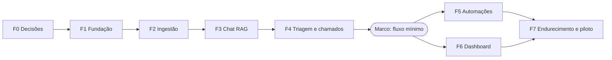

# H2D - TI: Plano de Implementação

Criado em 04/11/2026. Base: [H2D-TI-plano.md](H2D-TI-plano.md) (o "documento-base"). Acompanhamento: [TODO.md](TODO.md).

Este plano diz **em que ordem construir e como saber que cada fase terminou**. Arquitetura, stack e regras de negócio continuam no documento-base; aqui só aparece o que muda ou complementa.

## 1. Estratégia

1. **Fatias verticais.** Cada fase termina com algo demonstrável de ponta a ponta, implantado na VPS, e não com uma camada isolada.
2. **Núcleo primeiro.** O caminho crítico é F0 → F1 → F2 → F3 → F4. Ao fim da F4 existe o fluxo que não pode faltar: pergunta → resposta com fonte → não resolveu → chamado classificado → técnico notificado. Tudo depois disso pode ser cortado.
3. **Avaliação junto com o código.** Conjuntos de avaliação e testes de permissão nascem na fase da funcionalidade, não no final.
4. **Sem dependência de LLM para desenvolver.** Um cliente falso (`FakeLLM`) permite testar e desenvolver o front sem chave nem custo.

## 2. Visão geral das fases

**Entrega: 18/11/2026.** São 14 dias, contra as 6 semanas supostas no documento-base, então o corte da seção 6 já está aplicado. As fases se sobrepõem, porque cada pessoa trabalha em paralelo.

| Fase | Período | Entrega demonstrável | Pode cortar? |
| --- | --- | --- | --- |
| F0 Decisões | 04/11 a 05/11 | Perguntas em aberto respondidas, ADRs escritos | Não |
| F1 Fundação | 05/11 a 07/11 | Login funcionando em HTTPS na VPS, CI e deploy no ar | Não |
| F2 Ingestão | 06/11 a 09/11 | Admin envia um manual e o encontra na busca, com filtro de permissão | Não |
| F3 Chat RAG | 08/11 a 11/11 | Chat em streaming, com citações e recusa quando não sabe | Não |
| F4 Triagem e chamados | 10/11 a 14/11 | Chamado classificado, atribuído e notificado por e-mail | Não |
| F5 Automações (reduzida) | 14/11 a 15/11 | Erro global e vigia de SLA | Sim |
| F6 Dashboard (reduzido) | 14/11 a 16/11 | Defleção, custo, volume e SLA | Só além de defleção e custo |
| F7 Endurecimento (reduzido) | 15/11 a 17/11 | Backup restaurado, e2e no CI, demo ensaiada | Em parte |
| Congelamento | 17/11 | Só correção de defeitos; ensaio final | Não |
| **Entrega** | **18/11** | Demo do fluxo completo | |

O calendário supõe trabalho também nos fins de semana de 07/11 e 14/11. Sem eles, a folga acaba: corte a F5 inteira e o `Playwright`, mantendo apenas o roteiro manual da demo.

## 3. Fases em detalhe

### F0. Decisões

**Objetivo:** fechar o que muda o trabalho das fases seguintes. As recomendações abaixo valem como padrão, se o time não decidir de outro modo.

| Decisão | Recomendação | Motivo |
| --- | --- | --- |
| Data de entrega | **Decidido: 18/11/2026** | Define o que é cortado (seção 6) |
| Backend | Python (ADR-001) | Docling, LangGraph e Ragas nascem em Python; confirmar com os colegas |
| Plano do GitHub | Repositório criado como **privado**; tornar público, se quiserem proteção da `main` sem custo | Privado é reversível. Em repositório privado no plano Free, a proteção da `main` pode não ser aplicada, então até lá vale a convenção de só alterar a `main` por PR |
| Manuais | 10 a 15 fictícios | Não há manuais reais; servem também de demo |
| Notificação | E-mail no MVP | É o mínimo do documento-base; outro canal só se o time real usar |
| Embeddings | Por API na KVM 2, escolha final na F2 | Evita subir para KVM 4 antes de medir |
| Volume do piloto | Assumir 50 usuários e 100 documentos até haver número melhor | Serve de base para dimensionar |
| Divisão do time | Conforme o que cada colega domina | A divisão da seção 11 do documento-base é sugestão |

**Saída:** ADR-001 no repositório; divergências da seção 5 resolvidas; quadro do GitHub Projects com as issues da F1.

### F1. Fundação

**Objetivo:** esqueleto andando em produção desde a primeira semana, para que deploy não vire surpresa no fim.

- **Repositório:** `git init`, monorepo, proteção da `main`, CODEOWNERS, templates, pre-commit com gitleaks, `.env.example`, Makefile.
- **Ambiente local:** Compose com `db`, `api`, `worker`, `web`; extensões `vector` e `pg_trgm`; bancos `h2d` e `n8n` com usuários separados.
- **Backend:** FastAPI, Alembic, `/health`, `/ready`, auth com JWT em cookie httpOnly e argon2, papéis user/tech/admin.
- **Modelo de dados:** revisar o modelo inteiro de uma vez, mas migrar por fase. A F1 cria o grupo Cadastro e `audit_log`, mais um seed com usuários, técnicos, habilidades, categorias e SLAs.
- **Frontend:** Vite, roteamento, `tokens.css` com contraste validado, layout (barra lateral, cabeçalho, barra de status), login, cliente gerado do OpenAPI.
- **CI:** ruff, pyright, pytest com pgvector, eslint, tsc, vitest, checagem de contrato, build de imagens.
- **VPS:** endurecimento (SSH por chave, ufw, fail2ban), Caddy com TLS, deploy via GHCR com aprovação manual.

**Saída:**
- [ ] Login com usuário do seed funciona em `https://h2d.<domínio>`.
- [ ] PR com tipo divergente do OpenAPI faz o CI falhar.
- [ ] Um merge na `main` chega à VPS e termina com `/ready` verde.
- [ ] Banco inacessível de fora da VPS (testado com varredura externa).

**Armadilha:** o PostgreSQL 17 não tem `uuidv7()` nativo; gere os IDs na aplicação.

### F2. Ingestão

**Objetivo:** documento enviado vira trecho pesquisável, respeitando permissão.

- **Spike de embeddings (até meio dia):** comparar candidatos com 20 perguntas e fechar o ADR-002. A coluna `vector(N)` e o índice HNSW dependem da dimensão do modelo, então trocar de modelo com outra dimensão exige migração além de reindexação.
- **Pipeline:** Procrastinate, SHA-256, Docling, limpeza, chunking por título, embeddings em lote, publicação atômica, arquivamento da versão anterior.
- **Busca:** híbrida em SQL (vetor + `tsvector` + RRF), com filtro de visibilidade. Ativar a varredura iterativa do pgvector (`hnsw.iterative_scan`), senão o filtro pode devolver menos resultados que o pedido.
- **Endpoints:** upload, jobs, reindexação, `GET /kb/search`, `GET /kb/documents/{id}`.
- **Telas:** ingestão e jobs; base de conhecimento para o usuário.
- **Conteúdo:** manuais fictícios finais e conjunto de avaliação v0 (50 perguntas).
- **Medição:** `docker stats` durante o parsing do maior PDF, para definir limites de memória e decidir sobre a KVM 4.

**Saída:**
- [ ] Reenviar o mesmo arquivo não reprocessa; nova versão arquiva a anterior só depois de publicada.
- [ ] Falha no meio do job não deixa versão parcial ativa, e o motivo aparece na tela.
- [ ] **Teste automatizado:** usuário comum nunca recebe trecho restrito à TI.
- [ ] Acerto do trecho entre os top-k medido no conjunto v0, com linha de base registrada.

### F3. Chat RAG

**Objetivo:** bot que responde com fonte e reconhece quando não sabe.

- **Cliente LLM fino** sobre o OpenRouter, com `FakeLLM` e `llm_calls` gravado desde a primeira chamada.
- **Guardrails antes do primeiro envio ao LLM:** mascaramento de senha, CPF, cartão e token; limites de turnos, tokens e requisições; limite de gasto no provedor. O documento-base deixa LGPD para a Sprint 5, mas isso precisa existir antes de a conversa sair do servidor.
- **Agente LangGraph:** reescrita da pergunta, `search_kb`, geração delimitando trechos como dado, verificação de fidelidade, limiar de confiança, gatilhos de escalonamento (o escalonamento grava só o estado; o chamado nasce na F4). As tabelas do checkpointer ficam fora do Alembic; documentar como são criadas.
- **Versionamento de prompts** desde já, gravado com cada resposta.
- **API:** conversas, histórico, mensagens em SSE, feedback, `escalate`.
- **Tela de chat:** painel de fontes, 👍/👎, "falar com a TI", aviso sobre uso de IA. Como o envio é `POST`, o `EventSource` nativo não serve; use `fetch` com leitura de stream. O Colega A começa com um SSE simulado.
- **Avaliação no CI:** amostra de 10 casos por PR, conjunto completo à noite.

**Saída:**
- [ ] Pergunta coberta recebe resposta com citação que abre o trecho certo.
- [ ] Pergunta fora da base recebe "não encontrei" em vez de invenção.
- [ ] Teste com instrução maliciosa dentro de um manual não altera o comportamento.
- [ ] Senha colada não aparece em log, banco nem chamada ao LLM (verificado por teste).
- [ ] Metas de acerto definidas pelo time e medidas.

### F4. Triagem e chamados

**Objetivo:** fechar o fluxo mínimo. É o marco principal do projeto.

- **Classificador:** saída Pydantic, categorias vindas do banco, prioridade calculada em código pela matriz, conjunto rotulado (começar com 30 casos e crescer até 100 na F7).
- **Roteador:** habilidade, disponibilidade, carga ponderada, rodízio, fila de triagem manual, motivo gravado em `ticket_events`. Testes unitários puros, sem LLM.
- **Chamados:** criação a partir do escalonamento, com até 3 perguntas de esclarecimento; tema crítico vai direto; se o LLM cair, abre sem classificação.
- **Outbox e n8n:** `outbox_events`, entrega pelo worker com idempotência, n8n no Compose e workflow 1 (aviso de chamado) por e-mail, com P1 avisando também o líder.
- **Telas:** fila densa com `j`/`k`, detalhe com resumo e fontes, campo de solução aplicada, meus chamados.
- **Agente:** ferramenta `get_my_tickets`, somente leitura e limitada ao próprio usuário. Só é possível agora, porque depende dos chamados.
- **Cadastros:** o roteador usa o seed da F1, então não espera telas. CRUD de usuários, técnicos, habilidades, categorias, SLAs e regras de roteamento entra em paralelo (Colega B), gravando em `audit_log`.

**Saída (marco "fluxo mínimo"):**
- [ ] Demo completa na VPS, com o usuário e o técnico em navegadores separados.
- [ ] Derrubar o n8n, criar um chamado e religar: o aviso chega, sem duplicar.
- [ ] Derrubar o LLM (chave inválida): o chat oferece abrir chamado direto.
- [ ] Usuário só vê os próprios chamados (teste de autorização por papel).
- [ ] Acerto de categoria medido no conjunto rotulado.

### F5. Automações

**Em ordem de prioridade:** erro global (5), vigia de SLA (2), pesquisa de satisfação (4), relatório semanal (3).

- Endpoint de chamados em risco assinado com HMAC (ver divergência D3) e `POST` de avaliação CSAT.
- Workflows exportados sem credenciais em `n8n/workflows/`; poda do histórico de execuções.

**Saída:**
- [ ] Chamado de teste com prazo curto dispara alertas em 75% e 100%, uma única vez cada.
- [ ] Chamada sem assinatura válida recebe 401.
- [ ] Workflow forçado a falhar avisa o canal de TI.

### F6. Dashboard

**Obrigatórios para o MVP** (critério de sucesso do documento-base): **taxa de defleção e custo por conversa**.

**Depois, em ordem:** volume, backlog por técnico, SLA cumprido, MTTR, 1ª resposta humana, acerto da classificação, CSAT, lacunas da base. Inclui a tela "Minha carga" do técnico.

**Saída:**
- [ ] Cada KPI confere com uma consulta SQL escrita à mão sobre o seed.
- [ ] Técnico lê o dashboard, mas não altera nada (teste de papel).

### F7. Endurecimento e piloto

- **Operação:** backup com restic, **restauração testada de verdade**, Uptime Kuma, Sentry/GlitchTip, runbook, CSP e HSTS no Caddy.
- **Qualidade:** Playwright no fluxo chat → chamado, auditoria de acessibilidade, atalhos e paleta `Ctrl+K`, conjuntos de avaliação completos.
- **Admin:** configuração de IA (limiares, modelos, versões de prompt), tela de auditoria.
- **LGPD:** retenção, exclusão a pedido, revisão da política do provedor de LLM.
- **Ciclo de aprendizado:** rascunho de artigo a partir da solução, com aprovação do admin. É um bom final de demo, mas é o primeiro item a sair desta fase se faltar tempo.
- **Demo:** dados de demonstração e roteiro ensaiado pelo menos uma vez, na VPS.

**Saída:**
- [ ] Backup restaurado em ambiente limpo, com o tempo cronometrado.
- [ ] Critérios de sucesso do MVP (seção 11 do documento-base) todos marcados.
- [ ] Demo ensaiada sem intervenção manual.

### Depois do MVP

- **Fase 1.5:** reranking (só se a avaliação mostrar ganho), workflow 6 (validade de documentos).
- **Fase 2:** conforme a tabela da seção 1 do documento-base. Item novo vira issue aqui, sem entrar no MVP.

## 4. Quem faz o quê

Os colegas são Darles e Hanover; falta definir quem assume cada coluna.

| Fase | Tech lead | Colega A (front) | Colega B (dados e automação) |
| --- | --- | --- | --- |
| F0 | Conduz decisões, ADR-001 | Opina sobre a stack do front | Levanta temas dos manuais |
| F1 | Compose, VPS, CI, auth, modelo | Tokens, layout, login | Seed, Makefile, `.env.example` |
| F2 | Worker, Docling, busca | Telas de ingestão e base | Manuais, avaliação v0 |
| F3 | Agente, guardrails, LLM | Chat e fontes | Avaliação no CI, casos de ataque |
| F4 | Classificador, roteador, outbox | Fila e detalhe | CRUDs, workflow 1, conjunto rotulado |
| F5 | Endpoints de SLA e CSAT | Tela de avaliação | Workflows 2 a 5 |
| F6 | Endpoints de métricas | Dashboard | Validação dos KPIs |
| F7 | Backups, LGPD, tela de IA | Acessibilidade, atalhos | e2e, runbook, roteiro da demo |

**Apoio das skills do Claude Code:** `/tech-lead` no início de cada fase, `/ui-ux` nas telas da F1 à F6 e `/qa` antes de marcar qualquer fase como concluída. Serviços brasileiros e engenharia estrutural não se aplicam a este projeto.

**Risco de concentração:** o tech lead carrega a parte mais difícil de todas as fases e ainda revisa todos os PRs. Se atrasar, tudo atrasa. Reserve as revisões para um horário fixo do dia e passe parte delas para os colegas.

## 5. Divergências no documento-base

Precisam de uma decisão na F0. A coluna "Proposta" é o que este plano assume.

| # | Divergência | Proposta |
| --- | --- | --- |
| D1 | Custo de LLM e lacunas da base estão na **fase 2** (seção 1), mas custo por conversa é **critério de sucesso do MVP**, e os dois aparecem no dashboard (seção 7) | Custo por conversa no MVP; custo por chamado e lacunas ficam por último na F6 |
| D2 | O Caddy encaminha `/hooks` ao n8n, mas a API também tem `POST /hooks/n8n/*` | API em `/api/hooks/n8n/*`, chamada pela rede interna do Docker e bloqueada no Caddy |
| D3 | A regra é "lógica de negócio no backend", mas o vigia de SLA "consulta chamados em risco" sem endpoint previsto, e o diagrama liga o n8n ao banco | Novo endpoint assinado na API; o n8n só acessa o próprio banco `n8n` |
| D4 | Nenhum gatilho externo chega ao n8n no MVP: o worker o chama pela rede interna, e o e-mail para chamado é fase 2 | **Não expor o n8n publicamente no MVP.** Sem `hooks.<domínio>` até a fase 2, o que reduz a superfície de ataque |
| D5 | Faltam tabelas para a tela de IA (prompts, limiares), para `/admin/routing` e para os rascunhos de artigo | Criar `prompt_versions` (F3), `app_settings` (F4, inclui regras de roteamento) e `kb_drafts` (F7). A F1 já criou `sla_targets`, com os prazos de cada política por prioridade |
| D6 | Faltam endpoints: avaliação CSAT, histórico de conversas, carga do técnico | Incluir nas fases F3, F5 e F6 |
| D7 | O ciclo de aprendizado está no fluxo principal, mas não aparece em nenhuma sprint nem na tabela de escopo | Campo de solução na F4; geração de rascunho na F7, cortável |
| D8 | Mascaramento e aviso de IA ficam implícitos na Sprint 5 (LGPD), mas o LLM é chamado na Sprint 2 | Antecipar para a F3 |
| D9 | "multilingual-e5" parece erro de digitação, e não verifiquei se os modelos citados existem no FastEmbed nem se o OpenRouter oferece embeddings | Confirmar no spike da F2 |
| D10 | A seção 7 pede um console denso e monoespaçado, que foi reprovado ao ser visto | **Decidido:** ERP moderno com temática de TI: tema claro por padrão e escuro opcional, base em preto e cinza, Geist na interface, JetBrains Mono só em códigos. Gráficos com degradês e animações que respeitam o movimento reduzido |

### Telas com dados de demonstração

Todas as telas do ERP já existem, com dados fictícios de `apps/web/src/lib/demo/data.ts` e o selo "Dados de demonstração". Só o login é real. Cada fase troca os dados de demonstração pela API, e o selo sai junto. Entregar as telas não conclui nenhuma fase: os critérios de saída continuam valendo.

| Tela | Backend entra na |
| --- | --- |
| Documentos, Base de conhecimento | F2 |
| Assistente | F3 |
| Fila de chamados, Meus chamados | F4 |
| Dashboard | F6 |
| Cadastros, Auditoria, Configurações | Cortadas até 18/11 (seção 6): sem backend, tirar do menu ou manter o selo na demo |

## 6. Plano de corte

Esta seção prevalece sobre o detalhamento das fases acima.

**Já cortado para 18/11** (volta como backlog pós-entrega):

1. Rascunho de artigo (ciclo de aprendizado); o campo de solução aplicada continua
2. Tela de configuração de IA (valores ficam em variáveis de ambiente)
3. Relatório semanal e pesquisa de satisfação (com endpoint e tela de CSAT)
4. Paleta `Ctrl+K` e tela de auditoria (o registro em `audit_log` continua)
5. KPIs além de defleção, custo, volume e SLA; tela "Minha carga"
6. CRUDs admin (cadastros ficam só no seed)
7. Uptime Kuma e Sentry/GlitchTip

**Reduzido:** conjuntos de avaliação com 30 perguntas de RAG e 30 conversas rotuladas, em vez de 100 cada.

**Próximos cortes, se 14/11 chegar sem o fluxo mínimo:**

1. Vigia de SLA e workflow de erro global (F5 inteira)
2. Volume e SLA no dashboard
3. Teste `Playwright` (fica o roteiro manual da demo)
4. Agente LangGraph completo: perguntas de esclarecimento e `get_my_tickets`

**Nunca cortar:** F1 a F4 no essencial, teste de permissão, guardrails de dados, backup externo, defleção e custo no dashboard.

## 7. Riscos desta execução

Complementam a tabela de riscos do documento-base.

| Risco | Sinal de alerta | Resposta |
| --- | --- | --- |
| F4 termina tarde e sobra pouco para a demo | F3 ainda aberta em 12/11 | Aplicar os próximos cortes da seção 6 de imediato, sem esperar a F5 |
| VPS ou domínio demoram a sair | Sem acesso à VPS em 05/11 | Seguir no Compose local e implantar assim que sair; a demo não pode depender disso em 17/11 |
| Docling lento ou pesado demais | Parsing acima do limite de memória na F2 | MarkItDown como reserva, ou KVM 4 |
| Qualidade do RAG estagnada | Acerto abaixo da meta por 2 iterações | Revisar chunking e manuais antes de trocar modelo; depois, testar reranking |
| Colegas de Windows sem `make` | Dificuldade no primeiro setup | Documentar WSL2 ou Git Bash; todo comando também roda via `docker compose` |
| Avaliação de IA encarece o CI | Gasto acima do previsto em `llm_calls` | Amostra menor por PR; conjunto completo só à noite |
