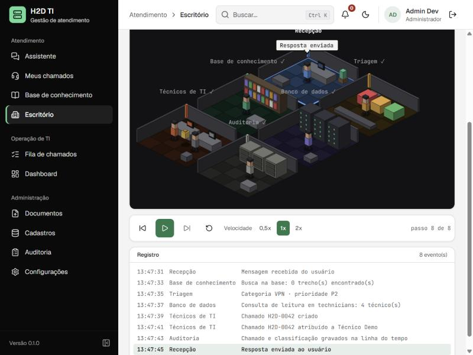
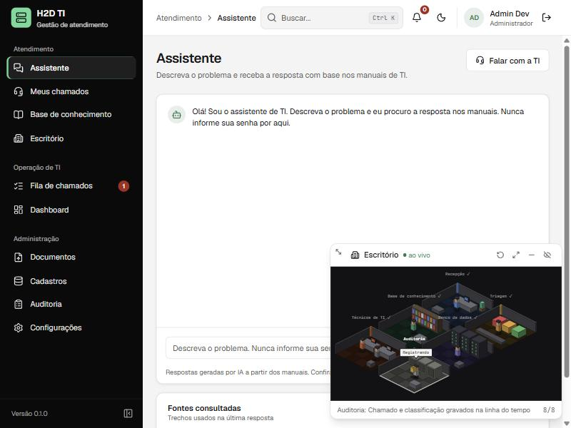

# Escritório virtual (experimento)

Uma tela animada, em pixel art isométrico, que mostra os agentes do sistema trabalhando em
tempo real a cada atendimento: a mensagem chega na **Recepção**, passa pela **Triagem**, pela
**Base de conhecimento**, pelo **Banco de dados**, chega aos **Técnicos de TI** e é registrada
pela **Auditoria**.

É um **experimento isolado**. Está atrás de uma flag, desligada por padrão. Com ela desligada, o
sistema se comporta exatamente como antes: nenhuma rota, nenhum item de menu, nenhum evento
gravado. Para descartar tudo, veja [Como desfazer](#como-desfazer).



## Como rodar localmente

Em desenvolvimento, as duas flags vão no `.env` (a API as lê do ambiente):

```bash
ESCRITORIO_VIRTUAL_ENABLED=true   # liga tudo (rotas, menu, eventos)
ESCRITORIO_VIRTUAL_DEMO=true      # libera a aba "Demonstração" (opcional)
```

Com o Docker Compose de desenvolvimento, repasse as variáveis ao serviço `api` (ou exporte-as
antes de subir) e rode a migração, que só cria a tabela nova `agent_events`:

```bash
docker compose up -d --wait
docker compose exec api alembic upgrade head
```

Abra `http://localhost:5173/escritorio` logado. O item **Escritório** aparece no menu
(grupo Atendimento).

Sem Docker (API e front direto na máquina), a partir de `apps/api`:

```bash
ESCRITORIO_VIRTUAL_ENABLED=true ESCRITORIO_VIRTUAL_DEMO=true uv run uvicorn h2d.main:app --port 8010
```

e, em outro terminal, a partir de `apps/web`:

```bash
npm run dev
```

### Ligar na VPS (Portainer)

O `docker-compose.yml` repassa as duas variáveis à API (`x-api-env`), com padrão `false`. Para
ligar: em Stacks → `h2d-ti` → Environment variables, cadastre `ESCRITORIO_VIRTUAL_ENABLED=true`
(e `ESCRITORIO_VIRTUAL_DEMO=true` se quiser a aba de demonstração) e faça **Pull and redeploy**.
Variáveis que não estão listadas no compose **não chegam ao container**, por isso uma variável
nova do stack só vale depois de entrar em `x-api-env`.

### Variáveis de ambiente

| Variável | Padrão | O que faz |
|---|---|---|
| `ESCRITORIO_VIRTUAL_ENABLED` | `false` | Liga o recurso: grava eventos, expõe as rotas e mostra o item de menu. |
| `ESCRITORIO_VIRTUAL_DEMO` | `false` | Mostra a aba **Demonstração**. Só vale com o recurso ligado. |
| `N8N_HMAC_SECRET` | (já existente) | Também assina o webhook que o n8n usa para enviar eventos. |

## Modos da tela

- **Ao vivo:** acompanha os atendimentos conforme acontecem (SSE). Se a conexão cair, reconecta
  sozinha e retoma sem repetir eventos. Com vários atendimentos, um seletor escolhe qual a cena
  mostra; as animações nunca se misturam.
- **Replay:** reproduz um atendimento já feito, com reproduzir/pausar, passo a passo (anterior e
  próximo), reiniciar e velocidade (0,5x, 1x, 2x).
- **Demonstração:** três cenários roteirizados, que rodam só no navegador e **não gravam nada**:
  1. dúvida resolvida pela base de conhecimento;
  2. consulta de status ao banco (só leitura);
  3. escalonamento para técnico (percorre as seis salas).

### Mini-escritório (canto das outras telas)

Com o recurso ligado, um mini-escritório flutua no canto inferior direito de **qualquer tela**
(menos da própria tela do Escritório), para acompanhar o fluxo sem sair do que se está fazendo.
Ele segue o atendimento que se mexeu por último e, ao abrir uma tela, já mostra como o último
atendimento terminou; o botão de rever repete a animação.



- **Opcional:** minimizar (vira só um botão), ocultar (some e fecha a conexão ao vivo) e religar
  pelo interruptor "Mini-escritório nas outras telas" na tela do Escritório. A escolha fica
  guardada no navegador (`h2d-escritorio-mini`).
- **Tamanho ajustável:** arraste a alça do canto superior esquerdo (ou use as setas, `Home` e
  `End` com ela focada). Clique duplo ou `Esc` voltam ao padrão (416 px). Vai de 288 a 960 px,
  sempre limitado à largura da tela, e a cena escala junto (`h2d-escritorio-mini-width`).
- Em telas estreitas (celular) ele não aparece, para não cobrir o conteúdo.

A cena respeita `prefers-reduced-motion` (sem animações, só a troca de sala) e tem descrição
acessível; o log usa `role="log"` com atualização educada para leitores de tela.

## Modelo de eventos

Tabela `agent_events` (migração `0006`), sem chaves estrangeiras de propósito: o evento é gravado
fora da transação do atendimento e nunca pode derrubá-la.

| Coluna | Descrição |
|---|---|
| `id` | UUID v7. |
| `ticket_id` | Chamado (pode ser nulo: o chamado só nasce no meio do atendimento). |
| `conversation_id` | Conversa do chat. Junto com o chamado, forma o "atendimento". |
| `room` | `recepcao`, `triagem`, `rag`, `banco`, `tecnicos` ou `auditoria`. |
| `agent_name` | Quem agiu (padrão por sala: Chatbot, Classificador, Busca RAG...). |
| `action` | O passo, por exemplo `mensagem_recebida`, `classificado`, `rag_busca`, `sql_leitura`, `chamado_criado`, `chamado_atribuido`, `resposta_enviada`. |
| `summary` | Texto curto, **já limpo** (até 200 caracteres). |
| `metadata` | JSON simples e limpo (categoria, prioridade, `top_k`, fontes...). |
| `user_id` | Dono do atendimento. Define quem pode ver o evento. |
| `created_at` | Horário da emissão (não da gravação). |

### O que nunca é gravado

`summary` e `metadata` passam por `mask_sensitive` (senhas, tokens, CPF, cartão). Chaves de
metadata com nome sensível (`password`, `token`, `api_key`, `cpf`...) são descartadas, e
metadata grande demais é descartada inteira. O texto digitado pelo usuário **não** vai para o
resumo: só o tamanho. Consultas ao banco registram o nome da tabela e a forma da query, sem
valores (`sql_metadata`).

## Como emitir um evento novo

No ponto do fluxo onde o passo acontece:

```python
from h2d.escritorio.events import emit_agent_event

emit_agent_event(
    room="rag",                     # uma das seis salas
    action="rag_busca",             # nome do passo
    summary="Busca na base: 3 trecho(s) encontrado(s)",
    conversation_id=conversation.id,
    user_id=conversation.user_id,   # sem isto só a TI vê o evento
    metadata={"top_k": 5, "encontrados": 3},
)
```

A função é segura para chamar em qualquer lugar: não espera o banco (grava em segundo plano com
sessão própria), engole qualquer erro, ignora salas inválidas e **não faz nada** com a flag
desligada. Para um texto de balão novo, acrescente a ação em `BUBBLES` em
`apps/web/src/features/escritorio/engine.ts` (até 22 caracteres); sem isso o balão usa o começo
do resumo.

### Pontos já instrumentados

| Sala | Ação | Onde |
|---|---|---|
| Recepção | `mensagem_recebida` | `chat/service.py` (`handle_user_message`) |
| Base de conhecimento | `rag_busca` | `chat/service.py`, depois de `search_chunks` |
| Triagem | `classificado` / `triagem_manual` | `tickets/service.py` (`create_ticket`) |
| Banco de dados | `sql_leitura` | `tickets/service.py`, consulta aos técnicos |
| Técnicos de TI | `chamado_criado`, `chamado_atribuido` / `aguardando_triagem` | `tickets/service.py` |
| Auditoria | `evento_registrado` | `tickets/service.py` |
| Recepção | `resposta_enviada` | `routers/chat.py` |

## API

Tudo sob `/api/escritorio`. Com a flag desligada **tudo responde 404**, menos a configuração, que
responde `enabled: false` (é assim que o menu sabe que não deve aparecer).

| Rota | Para quê |
|---|---|
| `GET /config` | `{enabled, demo}`. |
| `GET /atendimentos` | Atendimentos recentes (seletor da tela). |
| `GET /eventos?ticket_id=&conversation_id=&after=` | Eventos em ordem cronológica (replay). Pedir por chamado inclui os da conversa que veio antes dele. |
| `GET /stream?ticket_id=&conversation_id=&after=` | Eventos novos em SSE (`event: agent_event`). Retoma pelo cabeçalho `Last-Event-ID`. |
| `POST /api/hooks/n8n/escritorio/events` | O n8n envia eventos (assinado, veja abaixo). |

**Quem vê o quê:** usuário comum vê só os eventos dos próprios atendimentos; técnico e admin veem
todos. O mesmo vale para o SSE e para o REST.

### Decisões de implementação

- **SSE em vez de WebSocket:** o projeto já usa SSE no chat, o cookie de sessão funciona sem
  nada extra e o `EventSource` reconecta sozinho.
- **O stream consulta o banco a cada segundo**, em vez de usar um barramento em memória. Assim
  funciona com mais de um processo da API e com o worker emitindo eventos. A janela de
  sobreposição de 5 segundos evita perder eventos gravados com atraso. A latência é de até ~1 s.
- Cada conexão dura no máximo 5 minutos; o navegador reconecta e retoma de onde parou.
- A gravação do evento é assíncrona e com sessão própria: se o banco de eventos falhar, o chat e
  a criação do chamado seguem normalmente.

## n8n

O n8n pode enviar eventos para a mesma tabela, com o mesmo HMAC das outras rotas. Nenhum
workflow existente foi alterado; os nós a adicionar manualmente estão em
[n8n-escritorio.md](n8n-escritorio.md).

## Testes

```bash
# API (a partir de apps/api, com o Postgres de teste no ar)
uv run pytest tests/test_escritorio_events.py tests/test_escritorio_flow.py tests/test_escritorio_api.py

# Front (a partir de apps/web)
npx vitest run src/features/escritorio src/lib/navigation.flags.test.ts src/router.escritorio.test.tsx
```

Cobrem: emissão e falha silenciosa, flag desligada (nada emitido, mesmas respostas), autorização
por perfil no SSE e no REST, limpeza do texto, assinatura do webhook, transição entre salas e
estados da página (vazio, reconexão, demonstração, rota atrás da flag).

## Como desfazer

**Só desligar** (sem apagar nada): `ESCRITORIO_VIRTUAL_ENABLED=false` (ou remover a variável).
A tabela fica no banco, sem uso.

**Remover a tabela** (a migração `0006` só adiciona, e o `down` a remove):

```bash
docker compose exec api alembic downgrade 0005
```

**Descartar o experimento inteiro** (a partir da pasta do projeto principal):

```bash
git worktree remove ../h2d-ti-escritorio
git branch -D experimento/escritorio-virtual
git push origin --delete experimento/escritorio-virtual
git tag -d pre-escritorio-virtual
```

Se algum banco de desenvolvimento já recebeu a migração, rode o `downgrade` acima nele antes.

## Arquivos existentes que o experimento toca

`apps/api`: `config.py` (2 flags), `main.py` (registro das rotas), `chat/service.py`,
`routers/chat.py`, `tickets/service.py` (chamadas a `emit_agent_event`), `migrations/env.py` (um
import), `openapi.json`. `apps/web`: `components/AppShell.tsx`, `components/CommandPalette.tsx`
(item de menu atrás da flag), `lib/navigation.ts`, `router.tsx`, `lib/api/schema.d.ts` (gerado).
Todo o resto é código novo em `escritorio/` (API) e `features/escritorio/` (front).
